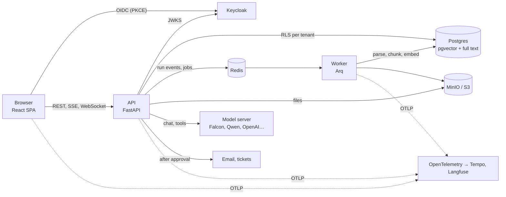

# Daleel · دليل

A bilingual (Arabic + English) copilot for enterprise documents. Upload policies and contracts, ask questions,
get streamed answers that cite the exact passage, and let an agent propose actions that a human approves.


<sub>Recorded with `qwen2.5:3b` on an M1 (native Ollama). Re-record with `e2e/scripts/record-demo.mjs`.</sub>

The full spec is in [docs/PLAN.md](docs/PLAN.md). The project is built in six gated phases.

## What it covers

| Area | In Daleel |
| --- | --- |
| LLM applications | Provider-agnostic `LLMProvider` (Falcon via vLLM, Ollama or AI71; OpenAI; any OpenAI-compatible server) with streaming, native and JSON-mode tool calling, token and cost accounting |
| RAG | Arabic-aware PDF/Word parsing with positions, heading-aware chunking, hybrid pgvector + full-text retrieval with RRF, streamed citations checked against what was retrieved, passage highlight in the PDF |
| Agents, human in the loop | Hand-written tool loop; side effects always pause for an approver, who can edit the arguments; exactly-once execution; append-only audit log |
| Arabic and English | Full RTL UI with logical CSS properties, every string translated, Arabic search normalization and stemming, reply-language detection |
| Frontend | React 19, TypeScript (strict), TanStack Query, Radix, Tailwind; SSE client with resume; WebSocket notifications; Storybook design system |
| Backend | FastAPI, Pydantic v2, async SQLAlchemy, Alembic, Arq workers, Redis Streams |
| Security | Keycloak OIDC (PKCE), JWT verified against JWKS, RBAC on every route, tenant isolation by Postgres row-level security, per-document ACLs in SQL, prompt-injection tests |
| Quality | pytest + Testcontainers (97% coverage), Vitest, Playwright with axe in both languages, keyboard-only flows, golden-set evals in CI |
| Operations | OpenTelemetry traces from browser to model, Prometheus and Grafana, Langfuse, Docker Compose, Helm chart tested on kind, GHCR releases scanned by Trivy |

## Architecture



A question streams back as server-sent events read from a Redis Stream, so a dropped connection resumes where it
stopped. The agent retrieves passages the asker may read, answers with citations, and pauses for a person
before any side effect. Details: [docs/ARCHITECTURE.md](docs/ARCHITECTURE.md) and the [ADRs](docs/adr).

| Phase | Scope | Status |
| --- | --- | --- |
| 1 | Foundations: monorepo, compose stack, Keycloak SSO, `/api/me`, CI | Done |
| 2 | Streaming chat over SSE through a provider-agnostic `LLMProvider` | Done |
| 3 | RAG ingestion, hybrid retrieval, citations, PDF highlight | Done |
| 4 | Agent loop with human approvals, audit log | Done |
| 5 | RBAC/ACL everywhere, admin console, observability, Storybook | Done |
| 6 | Evals in CI, Helm, release, live demo | Done except the live demo (needs hosting) |

## Quick start

Requirements: Docker with Compose v2, GNU Make. For running tests on the host: [uv](https://docs.astral.sh/uv/)
and Node 24 (pnpm comes from Corepack).

```bash
make up        # builds and starts everything; first run copies .env.example to .env
make smoke     # logs in as each demo user and checks roles + RBAC against the running stack
```

Open <http://localhost:5173> and sign in. Demo users (local only, password `demo`):

| User | Roles | `/api/admin/ping` |
| --- | --- | --- |
| `officer` | editor, approver | 403 |
| `viewer` | viewer | 403 |
| `admin` | admin | 200 |

| Service | URL |
| --- | --- |
| Web app | <http://localhost:5173> |
| API (OpenAPI docs) | <http://localhost:8000/docs> |
| Keycloak admin (`admin` / see `.env`) | <http://localhost:8180> |
| Mailpit (approved emails) | <http://localhost:8025> |
| Mock ticketing (approved tickets) | <http://localhost:8090> |
| MinIO console | <http://localhost:9001> |

Keycloak runs on 8180, not 8080, because 8080 is often taken. Change `KEYCLOAK_PORT` and the URLs that use it in
`.env` if needed.

## Documents and citations

Editors and admins upload PDF or Word files on the **Documents** page and choose which roles may see each one.
The worker parses the file (keeping each passage's page and position), splits it into ~500-token chunks under
their headings, embeds them, and indexes them for vector and keyword search; progress streams to the page.

Every answer is grounded in the six best passages the asker is allowed to read. Sources appear as numbered
chips: hover for the excerpt, click to open the PDF at that page with the passage highlighted. Citations to
anything that wasn't retrieved are removed before they reach you.

Demo documents (fictional company) are in [docs/demo](docs/demo): an Arabic procurement policy and an English
security policy.

## Actions and approvals

The assistant can act, not just answer. It searches and reads documents on its own, but anything that changes
the outside world waits for a person:

| Tool | What it does | Needs approval |
| --- | --- | --- |
| `search_documents`, `get_document`, `compare_clauses`, `summarize_document` | Read the documents you may see | No |
| `send_email` | Sends an email (local: lands in [Mailpit](http://localhost:8025)) | Yes, high risk |
| `create_ticket` | Opens a ticket (local: [mock ticketing](http://localhost:8090)) | Yes, medium risk |
| `flag_clause` | Flags a passage for its owners (editors only) | Yes, low risk |

The proposal appears as a card in the chat with the arguments as an editable form. Approvers (and admins) can
approve, edit and approve, or reject with a note; anyone else sees it waiting. The **Approvals** page lists every
pending request in your organisation. Approving resumes the answer where it paused; each approval executes at
most once. Undecided requests expire after 24 hours, and a new question in the same chat supersedes them. Every
request, decision and execution is written to an append-only audit log (`GET /api/audit`, admins).

Try it: ask *"Draft a reminder to procurement about the approval thresholds"*, approve the card, and open Mailpit.

## Administration and observability

Admins get an **Admin** page: usage over the last 30 days (questions, failures, time to first word p50/p95,
model tokens and cost, each chart also available as a table), everyone who has signed in with their roles, and
the audit log. Editors change who can see each document from the Documents page; answers stop citing it for
anyone who loses access immediately.

`make obs` starts the stack with tracing and metrics:

| Tool | URL | What you see |
| --- | --- | --- |
| Grafana (`admin` / `GRAFANA_ADMIN_PASSWORD`) | <http://localhost:3001> | Daleel dashboard: TTFT, traffic by route, tokens, cost, tool calls, approvals; traces in Tempo |
| Langfuse (`admin@daleel.local` / `LANGFUSE_ADMIN_PASSWORD`) | <http://localhost:3000> | Every model call with its prompt, answer, tokens, per chat and user |
| Prometheus | <http://localhost:9091> | Raw metrics (`daleel_*`) |

One trace follows a question from the browser (fetch) through the API, retrieval, the database and Redis to the
model server; the model call carries GenAI semantic-convention attributes, which is what Langfuse reads.

### Access control and accessibility, tested

- Every API operation rejects anonymous calls (the test walks the OpenAPI schema), and a role × endpoint matrix
  pins down who may do what.
- Every table with a `tenant_id` has forced row-level security and a policy (checked against the catalog).
- Playwright runs axe on every page in English and Arabic (no serious or critical violations), and a
  keyboard-only test asks a question, opens a citation and approves an email.
- `packages/ui` has Storybook (`pnpm --filter @daleel/ui storybook`) with the accessibility addon failing stories
  on violations.

## Evals

`make evals` checks retrieval and grounded answers against [a golden set](evals/golden.jsonl) of 42 questions
over the demo policies: English, Arabic, cross-lingual, and questions the documents can't answer. It ingests the
PDFs with the real worker code into a throwaway Postgres, searches with the API's hybrid retrieval, and answers
through the agent's prompt and citation filter.

| Metric | Meaning | Gate |
| --- | --- | --- |
| recall@6 | The passage holding the answer is among the six retrieved | ≥ 0.85 |
| citation precision | Cited passages hold the answer | ≥ 0.85 (0.80 with the fake model) |
| faithfulness | Cited sentences' words appear in the passages they cite | ≥ 0.80 |
| answer correctness, abstention | Expected facts in the answer; no citations for unanswerable questions | reported |

CI runs it with the fake model and embeddings (deterministic, no model). To evaluate a real one:

```bash
make evals EVALS_ENV="LLM_PROVIDER=openai_compat LLM_BASE_URL=http://localhost:11434/v1 LLM_MODEL=qwen2.5:3b"
```

| Run | recall@6 | citation precision | faithfulness | answer correctness |
| --- | --- | --- | --- | --- |
| CI (fake model, fake embeddings) | 1.00 | 0.83 | 1.00 | 0.53 |
| `qwen2.5:3b` on an M1, fake embeddings | 1.00 | 0.90 | 0.79 | 0.93 |

Why it is built this way: [ADR 0005](docs/adr/0005-evals-against-the-real-pipeline.md).

## Deploying to Kubernetes

The Helm chart in [deploy/helm/daleel](deploy/helm/daleel) runs the API, worker and web app with probes,
non-root users, read-only root filesystems, autoscaling and disruption budgets. The ingress sends `/api` straight
to the API with response buffering off (server-sent events) and long timeouts (the approvals WebSocket). Each API
pod applies migrations before it starts; an advisory lock makes concurrent pods take turns.

```bash
helm install daleel oci://ghcr.io/officialkhairi/charts/daleel --version 0.6.1 -f my-values.yaml
helm test daleel
```

Bring your own Postgres 16 with pgvector (create the app role first, as in
[deploy/compose/postgres/init](deploy/compose/postgres/init)), Redis, S3-compatible storage and an OIDC
provider; set them in `env` and `secretEnv` or point `existingSecret` at your own Secret. For a quick look,
`--set dev.enabled=true` adds throwaway Postgres, Redis and MinIO to the release. CI installs the chart on kind
with exactly that and runs `helm test` on every push.

Pushing a `v*` tag runs [release.yml](.github/workflows/release.yml): images for the API, worker and web app go
to GHCR (the release fails on fixable critical vulnerabilities found by Trivy, and the full report goes to code
scanning), then the chart is published as an OCI artifact.

## Choosing an embedding model

| `EMBEDDINGS_PROVIDER` | What it does |
| --- | --- |
| `fake` (default) | Hashes words into vectors: works offline, behaves like keyword search |
| `sentence_transformers` | Runs `BAAI/bge-m3` in the worker (downloads ~2.3 GB on first start). Multilingual: an English question finds Arabic passages |
| `openai_compat` | Any `/v1/embeddings` server, e.g. Ollama with `bge-m3` (`EMBEDDINGS_BASE_URL=http://ollama:11434/v1`, `EMBEDDINGS_MODEL=bge-m3`) |

Switching provider or model requires re-uploading documents, because vectors from different models can't be
compared.

## Choosing a model

`make up` starts with `LLM_PROVIDER=fake`, which streams "You said: …" so everything works without a model.
To use a real one, set these in `.env` and run `make up` again. Any OpenAI-compatible `/chat/completions` server
works.

| Server | `LLM_BASE_URL` | `LLM_MODEL` | `LLM_API_KEY` |
| --- | --- | --- | --- |
| Ollama on your machine | `http://host.docker.internal:11434/v1` | `qwen2.5:3b` | empty |
| Ollama in compose (`--profile local-llm`) | `http://ollama:11434/v1` | `qwen2.5:3b` | empty |
| vLLM | `http://<host>:8000/v1` | the served model name | optional |
| AI71 (hosted Falcon) | the base URL from your AI71 account | e.g. a Falcon model id | your key |
| OpenAI | `https://api.openai.com/v1` | e.g. `gpt-4o-mini` | your key |

Always also set `LLM_PROVIDER=openai_compat`. If the server rejects `stream_options`, set `LLM_STREAM_USAGE=false`.
`LLM_PRICE_IN_PER_MTOK` / `LLM_PRICE_OUT_PER_MTOK` turn token counts into the cost shown in `usage` events.

**On a Mac, run Ollama natively** (`brew install ollama && brew services start ollama`), not in compose:
Docker on macOS has no GPU access, so the compose profile runs on the CPU and needs most of Docker's memory.
Native Ollama uses the Apple GPU (Metal). Small models measured on an M1 (native Ollama, Daleel's agent prompts):

| Model | Size | Native tool calls (approvals) | Grounded English | Arabic | Speed |
| --- | --- | --- | --- | --- | --- |
| `qwen2.5:3b` | 1.9 GB | yes, correct arguments | yes, cited | fluent, weaker when grounding | ~2–4 s per answer |
| `granite4:3b` | 2.1 GB | yes | yes, cited | fluent, often uncited | ~1–2 s |
| `qwen3:4b` | 2.5 GB | yes | yes, cited | yes, cited | 10–50 s (always reasons first) |
| `falcon3:1b` | 1.8 GB | no (uses `LLM_TOOL_MODE=json`) | partly | weak | fast |

`qwen2.5:3b` is the default recommendation: it proposes `send_email` / `create_ticket` with valid arguments, so
the approval cards work end to end. Larger models (`qwen2.5:7b`, 4.7 GB) answer Arabic far better if you have
the memory. Models without tool calling still work: the API falls back to `LLM_TOOL_MODE=json` on its own.

## Development

```bash
make install   # uv sync + pnpm install
make infra     # backing services only
make dev-api   # API on :8000 with reload (runs migrations first)
make dev-web   # Vite on :5173, proxies /api to :8000
make lint      # ruff, mypy, eslint, tsc
make test      # pytest (Testcontainers Postgres, Redis, MinIO) + vitest
make e2e       # Playwright + axe against the stack, with the fake LLM (then `make up` to restore .env)
make evals     # golden-set evals (fake model by default, see Evals)
make obs       # the stack plus OpenTelemetry, Tempo, Prometheus, Grafana and Langfuse
make down      # stop; `make nuke` also deletes volumes
```

## How login works

1. The SPA redirects to Keycloak (Authorization Code + PKCE, public client `daleel-web`).
2. Keycloak returns an access token with `aud=daleel-api`, realm roles, and a `tenant` claim.
3. The SPA calls `/api/me` with the bearer token.
4. The API verifies the token itself against Keycloak's JWKS (cached, RS256 only, issuer and audience checked).
5. The API upserts the user inside a transaction scoped to the tenant: Postgres row-level security reads
   `app.tenant_id`, and the API connects as a non-superuser role, so the policy always applies.

Roles from the SPA are never trusted. Hiding UI is cosmetic; `require(role)` on the API decides.

## How streaming works

`POST /api/chats/{id}/messages` stores the question, starts a run in the background and returns
`text/event-stream`: `run.started`, `token`…, `usage`, optionally `error`, and always a final `run.completed`.
The run writes every event to a Redis Stream, and the HTTP response just reads that stream. So:

- **A dropped connection loses nothing.** The client reconnects to `GET /api/runs/{id}/events` with
  `Last-Event-ID` and continues where it stopped. Reloading the page resumes an answer that is still generating.
- **Stop is a server-side cancel** (`POST /api/runs/{id}/cancel`). The partial answer is saved and marked stopped.
- **Errors are data.** Provider failures arrive as an `error` event with `retryable`; the UI offers Try again,
  which regenerates the last answer (`POST /api/chats/{id}/retry`).

See [docs/ARCHITECTURE.md](docs/ARCHITECTURE.md) and [ADR 0002](docs/adr/0002-sse-with-redis-streams.md).

## Layout

```
apps/api         FastAPI: auth/, db/ (Alembic), api/, llm/ (provider contract), observability/
apps/worker      Arq jobs: parsing (PyMuPDF, python-docx), chunking, embeddings, approval expiry
apps/mock-ticketing  Stand-in for Jira/ServiceNow
apps/web         React 19 + Vite SPA (features/chat, documents, citations, auth, profile)
e2e              Playwright end-to-end tests
evals            golden.jsonl and the eval harness
packages/ui      Design tokens, shared components, Storybook
deploy/compose   docker-compose.yml, Keycloak realm, Postgres init, observability config
deploy/helm      Helm chart (kind smoke test values in ci/)
docs             PLAN.md, ARCHITECTURE.md, adr/, demo/ (sample policies)
```
